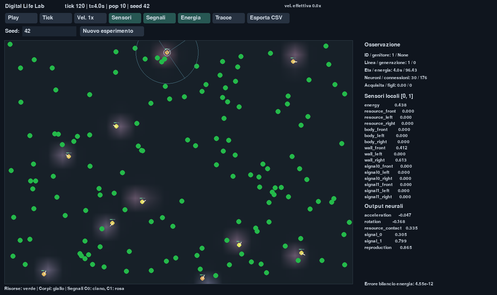

# Digital Life Lab — V1 e Milestone 4

Laboratorio desktop offline di Artificial Life: dieci organismi iniziali, un mondo continuo
2D, reti neurali NumPy, metabolismo, riproduzione asessuata, mutazioni strutturali e
plasticità individuale. La selezione avviene attraverso le conseguenze fisiche delle
azioni. Le statistiche non controllano gli organismi.



## Installazione

Richiede Python **3.12**, gestito da uv. Non servono GPU, account o servizi esterni.
Le dipendenze sono NumPy e **pygame-ce**; pytest e Ruff sono inclusi nel gruppo di sviluppo.
`uv.lock` blocca le versioni risolte. L'installazione iniziale richiede Internet.

### Windows — PowerShell

Se uv manca, installarlo seguendo la [documentazione ufficiale](https://docs.astral.sh/uv/getting-started/installation/),
per esempio con WinGet:

```powershell
winget install --id=astral-sh.uv -e
```

Aprire una nuova shell dopo l'installazione. Se uv è già in `$env:USERPROFILE\.local\bin`
ma non è nel PATH, aggiungere il percorso soltanto alla sessione corrente:

```powershell
$env:PATH = "$env:USERPROFILE\.local\bin;$env:PATH"
Set-Location C:\projects\discovery
uv python install 3.12
uv sync --locked
uv run python -m digital_ecosystem
```

### Linux — shell

Installare uv con l'[installer ufficiale](https://docs.astral.sh/uv/getting-started/installation/):

```sh
curl -LsSf https://astral.sh/uv/install.sh | sh
export PATH="$HOME/.local/bin:$PATH"
cd /percorso/digital-life-lab
uv python install 3.12
uv sync --locked
uv run python -m digital_ecosystem
```

La GUI richiede una sessione grafica disponibile. Dopo `uv sync`, l'applicazione non usa
la rete. Per impedire anche a uv di accedere alla rete, usare `uv run --offline ...`.
In ambienti con cache globale non scrivibile, impostare `UV_CACHE_DIR` a `.uv-cache`
all'interno del progetto.

## Avvio e controlli

```sh
uv run python -m digital_ecosystem
uv run python -m digital_ecosystem --headless --steps 100000 --seed 42
uv run python -m digital_ecosystem --config configs/diagnostic.toml --seed 42
uv run python -m digital_ecosystem --headless --steps 1000 --export-csv
uv run pytest
uv run ruff check .
```

`--output DIR` sceglie la cartella dei risultati, predefinita `experiments/`.
`--seed` accetta interi da 0 a 2^63−1; `--steps` specifica i tick della modalità headless.
La GUI resta aperta fino alla chiusura; `--gui-frames N` serve per le verifiche automatiche.

| Controllo | Effetto |
| --- | --- |
| Click su un corpo | Ispezione di ID, genealogia, energia, età, rete, sensori e output |
| Pausa / Play, barra spaziatrice | Ferma o riprende il tempo simulato |
| Tick, tasto punto | Avanza esattamente un tick e mette in pausa |
| Velocità | Cicla tra 1×, 4×, 16× e 64× |
| Sensori / Segnali / Energia / Tracce | Attiva o nasconde gli overlay |
| Campo Seed + Nuovo esperimento, oppure Invio | Salva l'esperimento corrente e crea una nuova esecuzione |
| Esporta CSV | Salva i dati osservati fino al tick corrente |
| Esc / chiusura finestra | Salva e termina |

La GUI mostra la velocità effettiva. Le velocità richieste sono obiettivi: se il computer
non le sostiene, avanza meno tick mantenendo invariato il timestep fisico. Dimensione
consigliata della finestra: 1380 × 820; finestre molto piccole possono tagliare il pannello.
Le tracce sono uno storico grafico limitato e non dati di traiettoria completi.

## Configurazioni e protocollo scientifico

- **`configs/experimental.toml`**: preset predefinito della CLI. Non contiene salvataggi
  della popolazione, collocazione preferenziale presso risorse, reward o fitness.
- **`configs/diagnostic.toml`**: stesso motore, con energia iniziale maggiore, costi ridotti,
  risorse più grandi e soglia riproduttiva più bassa. Serve a esercitare i componenti;
  non è una baseline neutrale e non garantisce la sopravvivenza.

Il caricamento TOML rifiuta campi sconosciuti, tipi errati e parametri non finiti o
incompatibili. Per evitare attraversamenti tra tick, `dt * max_speed` deve essere al
massimo pari al raggio corporeo. I parametri non presenti in un TOML esplicito usano i
default documentati dal preset sperimentale e dalle dataclass di configurazione.
Il file sperimentale è incluso anche nella distribuzione wheel.

Controlli indipendenti:

```sh
uv run python -m digital_ecosystem --headless --steps 10000 --seed 42 --no-plasticity
uv run python -m digital_ecosystem --headless --steps 10000 --seed 42 --no-mutations
uv run python -m digital_ecosystem --headless --steps 10000 --seed 42 --no-signaling
```

Protocollo fattoriale con dieci seed, otto combinazioni e parametri fisici identici:

```sh
uv run python -m digital_ecosystem --headless --steps 10000 --compare-seeds 0,1,2,3,4,5,6,7,8,9 --output experiments/comparison
```

La modalità comparativa richiede almeno due seed distinti e imposta esplicitamente tutte
le otto combinazioni, indipendentemente dai flag `--no-*`. Produce `comparison_runs.csv`,
`comparison.json` e gli esperimenti SQLite separati. Il riepilogo contiene numerosità,
media, deviazione standard campionaria, minimo e massimo; non esegue test di significatività
né interpreta automaticamente adattamento, cooperazione o comunicazione. Seed abbinati
garantiscono le stesse condizioni iniziali; genealogie e eventi successivi possono divergere.

## Regole imposte e processi osservabili

### Corpo, mondo ed energia

Il mondo misura 1000 × 700 unità. Corpi circolari hanno massa, posizione, orientamento,
velocità, energia e sensori orientati. Le risorse sono depositi circolari attraversabili:
si raccolgono per contatto, con attivazione neurale e capacità interna sufficiente.
Le richieste concorrenti su un deposito sono soddisfatte proporzionalmente. Depositi
multipli sono elaborati in ordine stabile; il limite di capacità è rispettato a ogni trasferimento.

Ogni tick esegue metabolismo e mortalità preliminare, percezione dello stato corrente,
inferenza e plasticità, azioni fisiche, collisioni e raccolta, mortalità finale,
riproduzione, rigenerazione, diffusione dei segnali e osservazione. Tutti i cervelli
leggono la geometria prima che i corpi siano mossi. Le azioni sono ridimensionate quando
il corpo non può pagarne il costo. La riproduzione richiede output, energia, cooldown e
posizione valida; una richiesta respinta non addebita il costo riproduttivo.

Il bilancio verifica:

```text
energia_corpi + energia_depositi = energia_iniziale + rigenerazione - dissipazione
```

Raccolta e trasferimento alla prole sono trasferimenti interni, non nuova energia.
La dissipazione distingue metabolismo, azioni, riproduzione e residuo alla morte.
Il cadavere scompare: il residuo è dissipato, non restituito ai depositi. La rigenerazione
è l'unica introduzione energetica successiva all'inizializzazione. Il modello contabilizza
energia metabolica utilizzabile, non un bilancio termodinamico di energia cinetica e calore.

Collisioni e pareti sono vincoli geometrici con risposta inelastica e solver iterativo
limitato. Il numero di iterazioni è configurabile; configurazioni estremamente affollate
richiedono verifiche specifiche. Non sono presenti predazione, danni o trasferimenti di
energia tra corpi oltre alla riproduzione. L'età massima è disabilitata nel preset sperimentale.
Il limite di 256 organismi è computazionale (`max_population = 0` lo disattiva): tutte le
richieste energeticamente valide bloccate vengono registrate, senza eliminare altri individui.

### Reti, apprendimento ed ereditarietà

La rete iniziale ha 16 input, 8 neuroni nascosti e 6 output, con 176 connessioni.
Le fondatrici condividono la topologia e un genoma base casuale con piccole perturbazioni.
Gli input comprendono energia e tre settori relativi al corpo per risorse, altri corpi,
pareti e ciascuno dei due segnali. Gli output sono accelerazione, rotazione, contatto con
risorse, due emissioni e richiesta riproduttiva. I neuroni usano tanh; gli ultimi quattro
output sono mappati in [0, 1]. Nessun output rappresenta una strategia astratta.

Il genoma contiene soltanto parametri ereditabili. Brain mantiene separatamente
attivazioni e variazioni apprese; il genoma non cambia durante la vita.

```text
delta += dt * (learning_rate * attività_pre * attività_post - plastic_decay * delta)
peso_effettivo = clip(peso_genetico + clip(delta, ±plastic_bound), ±parameter_bound)
```

Questa plasticità hebbiana non garantisce apprendimento adattivo e non contiene reward.
La prole parte con delta nullo. Mutazioni possono modificare pesi, bias, connessioni e
neuroni nascosti. Ingressi e uscite restano fissi; l'aggiunta di connessioni rispetta un
ordine topologico, quella di un neurone divide una connessione. Non è implementato NEAT
completo, crossover, speciazione o selezione per punteggio. La complessità riportata
conta tutti i neuroni, inclusi ingressi e uscite.

### Segnali

Due canali non negativi e indipendenti diffondono su una griglia 25 × 18, con pareti
riflettenti, decadimento esponenziale e durata massima di 30 tick nel preset standard.
Ogni emissione è depositata nel punto di griglia più vicino; la percezione usa interpolazione
bilineare su tre sonde locali. La durata massima e la griglia sono proprietà fisiche imposte.
Una traccia persiste dopo la morte dell'emettitore fino alla scadenza.

L'implementazione conserva due campi aggregati, kernel separabili condivisi e storici
circolari NumPy limitati. Sottrae il contributo proprio dai sensori e rimuove le emissioni
scadute con lo stesso operatore di diffusione, senza griglie complete per ogni individuo.
I test confrontano il risultato con un riferimento per emettitore entro 2 × 10⁻¹².
Le minime differenze da cancellazione numerica vengono limitate a concentrazioni non negative.
`--no-signaling` rimuove campi, input dei segnali, emissioni e relativi costi; gli output
neurali possono restare numericamente diversi da zero, ma non producono effetti ambientali.

### Isolamento e modularità

Brain accetta esclusivamente un vettore numerico e restituisce controlli fisici.
Organism non riceve filesystem, sistema operativo, rete o servizi. World e Physics
elaborano gli effetti locali; logger, CLI e renderer sono componenti esterni al cervello.
L'isolamento è architetturale: non è una sandbox per codice arbitrario o plugin ostili.
World espone interrogazioni geometriche e trasferimenti energetici, mentre Physics
applica i comandi: futuri materiali o manipolazioni potranno estendere queste interazioni.
Non sono implementati materiali modificabili, strumenti, costruzioni, Neural Inspector o dashboard.

## Checkpoint e ripresa — Milestone 4

La versione 0.2.0 aggiunge archivi **`.dlcp` autosufficienti**: stato numerico completo,
configurazione, generatori casuali, genomi, plasticità acquisita, genealogia, bilancio,
risorse, campi e storici dei segnali, più SQLite con il solo esperimento interessato.
Non serve il database originale. Il formato è versionato, con checksum e array NumPy
senza pickle. Il nucleo numerico, Python, build NumPy, sistema operativo, architettura,
capacità CPU e impostazioni numeriche devono essere compatibili. Le differenze LF/CRLF
delle sorgenti non cambiano la compatibilità.

```toml
[checkpoint]
enabled = true              # Salvataggi automatici; manuale e chiusura restano disponibili
interval_ticks = 10000
previous_versions = 3        # Almeno tre precedenti oltre alla versione corrente
```

I file sono sotto `OUTPUT/checkpoints/EXPERIMENT_ID/`. Si salva ogni 10000 tick, mediante
**Salva .dlcp**, alla chiusura regolare e prima di sostituire l'esperimento corrente.
Richieste coincidenti sul medesimo stato vengono accorpate. Il salvataggio avviene soltanto
dopo un tick completo, con temporaneo, controllo CRC, sincronizzazione e pubblicazione
atomica. I precedenti sono ruotati soltanto dopo una pubblicazione riuscita.

```sh
uv run python -m digital_ecosystem --headless --resume percorso/salvataggio.dlcp --steps 10000 --output experiments/ripresa
uv run python -m digital_ecosystem --resume percorso/salvataggio.dlcp
```

`--steps` indica **tick aggiuntivi**, non il tick finale. Se `--output` è omesso, il database
operativo viene creato nella directory del checkpoint. La CLI distingue argomenti omessi
e valori espliciti: `--resume` rifiuta `--seed`, `--config`, i tre flag `--no-*` e
`--compare-seeds`, anche quando i valori sembrano corrispondere ai default. I parametri
salvati non vengono sovrascritti. Il caricamento GUI parte sempre in pausa.

Nella GUI, **Recenti** cicla i checkpoint disponibili; il campo percorso è modificabile
e **Carica** o Invio lo apre. Se un salvataggio fallisce la GUI rimane in pausa, conserva
il checkpoint precedente e permette di riprovare. Una chiusura regolare fallita viene
sospesa. Ctrl+C nella CLI richiede l'arresto al confine del tick; un errore interno a un
tick non produce un checkpoint parziale.

Se il database di destinazione coincide con lo stato archiviato, la ripresa continua
lo stesso UUID. Se contiene una prosecuzione o dati divergenti, crea una **diramazione**
con nuovo UUID e prefisso storico importato, preservando i dati della traiettoria originale.
Il prefisso condiviso non è una replica indipendente. Il lock dell'esperimento impedisce
due scrittori simultanei e viene rilasciato dal sistema operativo anche dopo arresto forzato.
Eventi già registrati sono idempotenti per sequenza; payload discordanti vengono rifiutati.

L'esportazione SQLite è selettiva e transazionale: non copia altri esperimenti né genomi
non referenziati. Il database incorporato usa viste per esporre le tabelle consuete senza
ripetere l'UUID in ogni riga fisica. Le coordinate dei depositi sono conservate per versione
geometrica, con energie campionate separate: anche posizioni cambiate durante un esperimento
vengono ricostruite senza perdita. Le migrazioni del database operativo conservano un
backup prima di modificare uno schema V1 esistente. I genomi sono archiviati integralmente
alle nascite e deduplicati; genomi storici mancanti dai vecchi dati non vengono inventati.

Un arresto forzato può perdere i tick successivi all'ultimo checkpoint valido e lasciare
temporanei `.saving-*`, che non vengono caricati. Checkpoint corrotti o incompatibili sono
rifiutati prima di modificare la sessione. Non si recupera uno stato numerico dalle sole
statistiche. La verifica di prestazioni richiede sei esecuzioni sequenziali da 100000 tick,
confrontando le mediane di tre coppie e un budget del 10%:

```sh
uv run python tools/benchmark_checkpoints.py --steps 100000 --repeats 3 --extras
```

Le prove della V1 restano in `docs/VALIDATION.md`; i risultati specifici della Milestone 4
sono in [docs/M4_VALIDATION.md](docs/M4_VALIDATION.md), con misure complete in
[docs/m4-performance.json](docs/m4-performance.json).

## Dati e riproducibilità

`experiments/lab.sqlite3` conserva più esecuzioni, ciascuna con UUID, seed, configurazione
effettiva, versione, hash delle sorgenti, versioni software e timestamp UTC.

| Tabella | Contenuto |
| --- | --- |
| experiments | Metadati, stato running/completed/restarted/interrupted/failed e riepilogo |
| samples | Tick iniziale/finale e campioni ogni 30 tick; popolazione, energia, genealogie, complessità, diversità, contatori e bilancio |
| resources | Posizione ed energia di ogni deposito a ciascun campione |
| events | Tutte le nascite, morti con causa, richieste bloccate da spazio o capacità |
| individuals | Genitore, linea, generazione, durata, energia acquisita, figli diretti, discendenti totali e firma genetica |
| genomes / birth_genomes | Snapshot genetici completi compressi, deduplicati e collegati alle nascite |
| experiment_heads / experiment_origins | Cursori deterministici della cronologia e provenienza delle diramazioni |
| resource_geometry_history | Posizioni iniziali e modifiche geometriche osservate dei depositi |

La durata della vita degli organismi ancora vivi è **censurata**: `lifespan` resta NULL,
mentre `observed_age` indica il periodo osservato. I discendenti comprendono tutte le
generazioni successive. La diversità è la media di distanza Jaccard tra nodi, distanza
Jaccard tra connessioni e differenza normalizzata dei parametri condivisi. Fino a 128 coppie
sono scelte deterministicamente dagli ID, senza consumare casualità del motore.
È una misura descrittiva approssimata, non una misura universale di diversità biologica.

Emissioni e contatti sono contatori cumulativi. Frequenze per intervallo si ricavano da
`Δcontatore / Δsimulated_time`; le emissioni contano intensità maggiori di 10⁻¹².
Le aggregazioni di popolazioni vuote sono zero, mentre le durate censurate restano NULL.
Gli organismi non accedono a nessuna di queste metriche.

Le scritture sono raggruppate in transazioni, con salvataggio finale su chiusura o Ctrl+C
(codice di uscita 130). Un arresto forzato o un guasto del disco può perdere l'ultimo batch;
la ripresa richiede un checkpoint completo valido. Gli eventi sono drenati dal logger a ogni tick.
La genealogia rimane in memoria e può crescere in esperimenti con moltissime nascite.

A parità di seed, configurazione, sorgenti e ambiente software, il motore è riproducibile.
Flussi casuali separati controllano ambiente, fondatrici, genomi, collocazione e mutazioni.
Renderer e logger non consumano questi flussi; non si promette identità bit per bit tra
versioni diverse di Python/NumPy, sistemi operativi o architetture.

## Struttura, verifiche e prestazioni

```text
configs/                    experimental.toml, diagnostic.toml
src/digital_ecosystem/      configuration, world, organism, genome, brain,
                            sensors, physics, reproduction, signals, simulation,
                            renderer, experiment_logger, comparison, state,
                            checkpoint, storage, __main__
tests/                      core, evolution, signals, logging, comparison, CLI/GUI
tools/                      benchmark.py, benchmark_checkpoints.py,
                            capture_gui.py, inspect_results.py
docs/                       VALIDATION.md, benchmark.json, gui.png
pyproject.toml              dipendenze, packaging, pytest, Ruff
uv.lock                     versioni bloccate
```

I risultati effettivamente eseguiti sono in [docs/VALIDATION.md](docs/VALIDATION.md).
Il benchmark riproducibile si avvia con:

```sh
uv run python tools/benchmark.py --steps 180 --output docs/benchmark.json
```

Misura il motore con 10, 100 e 256 individui, segnali attivi e disattivi, senza renderer
o logger. Le condizioni di benchmark mantengono una popolazione fissa mediante parametri
diagnostici dichiarati; non modificano i preset. I tempi dipendono dalla macchina e il
massimo computazionale non implica funzionamento in tempo reale. A popolazioni elevate
la velocità può scendere sotto 1×. Le misure di memoria distinguono buffer NumPy e
allocazioni tracciate; non rappresentano la memoria RSS totale del processo.

I test comprendono almeno tre seed e tutte le otto combinazioni di controllo. Un esito
di estinzione o l'assenza di emergenza non giustificano aggiustamenti automatici. La V1
fornisce osservazioni e confronti descrittivi, non dimostrazioni di intelligenza o
comunicazione significativa.
