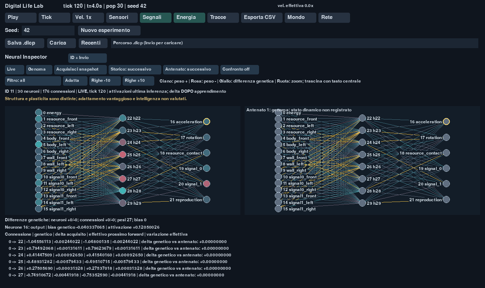

# Milestone 5 — verifica del 15 ottobre 2026

Neural Inspector integrato in Pygame, snapshot persistenti su richiesta,
confronto dei genomi ancestrali e consultazione degli organismi morti quando i
dati sono disponibili. Il nucleo numerico M4 è invariato: hash
`8050b05655ecd43ed9381a9d0c8290563e68814cabd19c88996f4f8f18b93d71`.

## Test e compatibilità

Prima dello sviluppo M6, la suite M5 ha completato **140 test in 343,27 s**.
Il risultato della suite finale estesa è riportato in [M6_VALIDATION.md](M6_VALIDATION.md).

Verifiche esercitate con risultati effettivi:

- Snapshot distaccati, nessuna inferenza o apprendimento invocati, nessun consumo
  di casualità, identità dello stato completo prima e dopo l'osservazione.
- Matrice di tre seed e otto combinazioni di plasticità, mutazioni e segnali:
  snapshot e riprese ai tick 17, 41 e 120; stato completo, eventi, campioni e
  individui identici al controllo senza Inspector.
- Fixture binaria prodotta da M4 prima delle modifiche: caricamento, UUID
  conservato e fingerprint completo atteso ai tick 17, 41 e 120. Migrazione del
  database operativo M4 originale, rollback con backup integro e ripresa.
- Snapshot durante la pausa inclusi in un nuovo checkpoint autosufficiente;
  acquisizioni ripetute idempotenti; rollback e replay delle revisioni dopo errori
  SQLite. Le sole osservazioni non producono diramazioni.
- Diramazioni da tick precedenti e stati divergenti allo stesso tick: nessuno
  snapshot importato dalla prosecuzione futura della destinazione.
- Disponibilità storica esplicita, delta genetici separati dai delta acquisiti,
  clipping dei pesi effettivi, controlli su payload e checksum.
- GUI: ricerca ID, selezione, snapshot, confronto ancestrale, filtri e aggiornamento
  delle attivazioni anche quando il genoma alla nascita è nella cache.

I test della fixture non aggirano la verifica dell'ambiente M4: su piattaforme
numericamente diverse vengono saltati con una motivazione esplicita. In questa
esecuzione Windows il caricamento è stato realmente verificato.

## Benchmark

Ambiente: Windows 11 AMD64, Python 3.12.15, NumPy 2.5.4, pygame-ce 2.5.8.
Dati completi: [m5-performance.json](m5-performance.json).

Tre coppie M4/M5, ordine alternato, **100.000 tick per esecuzione**, seed 42,
preset sperimentale effettivo con raggio risorse 20 e checkpoint automatici.
Ogni coppia ha gli stessi fingerprint finali e lo stesso hash di tutti i campioni.

| Misura | Risultato | Soglia |
| --- | ---: | ---: |
| Mediana headless M4 | 591,35 s | riferimento |
| Mediana headless M5 | 580,42 s | overhead ≤10% |
| Overhead mediano osservato | −1,85% | superata |
| Snapshot persistente, 10 organismi, p95 | 20,97 ms | ≤250 ms |
| Snapshot persistente, 100 organismi, p95 | 82,10 ms | ≤250 ms |
| Snapshot persistente, 256 organismi, p95 | 203,96 ms | ≤250 ms |
| Ridisegno completo Inspector, 96 neuroni / 1.500 connessioni, p95 | 4,40 ms | ≤10 ms |
| Stesso grafo, tutti i pesi acquisiti variabili, p95 | 5,08 ms | ≤10 ms |

L'overhead negativo indica variabilità delle misure; non dimostra un'accelerazione
del motore. Come autorizzato, M6 è stata sviluppata durante il benchmark lungo
eseguito su sorgenti M5 congelate, il cui manifest è in
[m5-frozen-sources.json](m5-frozen-sources.json). Le successive ottimizzazioni
riguardano acquisizioni manuali e disegno e sono misurate separatamente sul
codice finale; non sono usate nei percorsi delle sei esecuzioni headless.

Gli snapshot sono misurati su 12 acquisizioni persistenti per popolazione,
includendo fingerprint completo e commit SQLite. Il grafo massimo è una fixture
sintetica dichiarata, distinta dalle traiettorie scientifiche: 100 frame, primi
10 esclusi, acquisizione dinamica distaccata a ogni frame. Nel secondo scenario
tutti i delta cambiano a ogni frame. SDL usa il driver dummy per misure ripetibili;
l'immagine sottostante è acquisita con una finestra Windows reale.

La prima misura aveva superato i budget: 723,56 ms per lo snapshot a 256 individui
e 30,53 ms per il ridisegno. Il report è conservato in
[m5-performance-before-optimization.json](m5-performance-before-optimization.json).
Le correzioni riusano serializzazioni scalari equivalenti, genomi distaccati,
etichette e pixel; non riducono la precisione o i dati scientifici.

```powershell
.venv\Scripts\python.exe tools/benchmark_observation.py --baseline experiments/m4-baseline/src --steps 100000 --repeats 3 --root experiments/m5-recheck --output experiments/m5-recheck.json
```

Il riferimento deve contenere una copia M4 originale. Usare una directory nuova;
i parametri effettivi sono registrati nel report. Per sole acquisizioni e GUI,
`--render-only` evita le sei esecuzioni lunghe.

## Limiti e immagine

Gli snapshot restano manuali; il contratto di campionamento futuro è predisposto
senza schedulatore attivo. Un genoma archiviato non contiene le attività della
vita passata; l'ultimo snapshot non viene presentato come stato esatto alla morte.
Il layout di una rete densa presenta sovrapposizioni: selezione, zoom, filtri e
tabella permettono di esaminare i valori individuali. Layout e ricostruzioni
iniziali della cache non sono inclusi nel p95 dei frame a regime.

Complessità strutturale e plasticità non dimostrano adattamento vantaggioso o
maggiore intelligenza. La riproducibilità bit per bit conserva gli stessi vincoli
di ambiente numerico della M4. Le prestazioni dipendono da macchina e carico.


