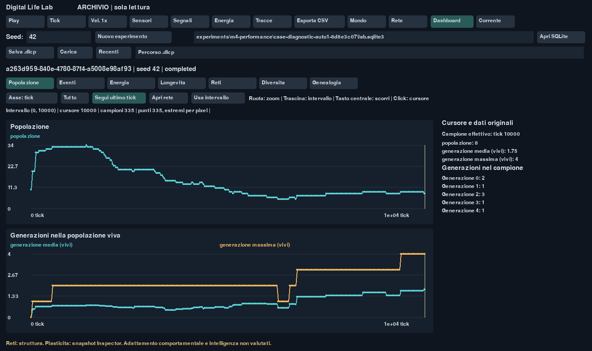
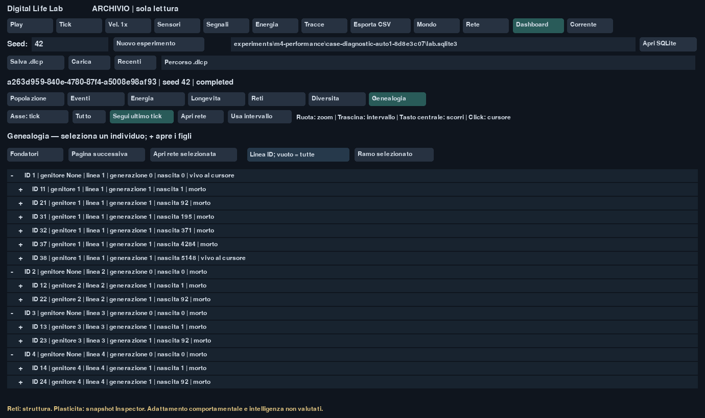

# Milestone 6 — verifica del 15 ottobre 2026

Dashboard evolutiva integrata nell'applicazione Pygame, disponibile per
l'esperimento corrente e per archivi SQLite aperti in sola lettura. Include
serie storiche, intervalli, cursore, tooltip dei campioni originali, generazioni,
cause di morte registrate, energia, longevità, struttura delle reti, diversità
genetica e genealogia espandibile con accesso al Neural Inspector.

## Test funzionali e riproducibilità

La suite dedicata alla dashboard ha completato **25 test in 16,88 s** prima
del benchmark finale. La suite complessiva e il packaging sono verificati nella
sessione finale descritta sotto.

La suite completa ha completato **175 test in 407,66 s**, senza errori o skip.
Comando eseguito: `.venv\Scripts\python.exe -m pytest -q
--junitxml=experiments/m56-tests-final.xml`. Comprende tutte le verifiche M4,
M5 e M6; i report JUnit locali sono nella directory esclusa `experiments`.

Una prima suite estesa ha dato 174 successi e un errore nel nuovo test di
paginazione: un intervallo dal tick 1 includeva record del tick 0. Il limite
composto è stato corretto; il test dei 1.203 record e i 25 test della dashboard
sono poi passati insieme (**26 passed in 11,95 s**).

Il controllo aggiuntivo del browser ha inoltre rilevato e corretto due casi
dell'Inspector: accesso al mondo inesistente nella modalità senza simulazione e
cache non invalidata passando prima della nascita dell'individuo. I test ora
esercitano entrambi i casi, oltre al cambio di attivazioni su un genoma in cache.
La successiva riesecuzione di tutti i test CLI/GUI e dashboard ha completato
**33 test in 18,39 s**, senza errori, sulle sorgenti definitive.

I test coprono:

- Valori storici verificati contro una fixture indipendente di nascite e morti:
  medie, mediane, classi della longevità e censura degli individui ancora vivi.
- Tassi calcolati prima della riduzione grafica, con intervalli effettivi; energia
  della prole non contata due volte; estremi e lacune dei campioni conservati.
- Le sei famiglie di grafici senza modificare i byte dell'archivio SQLite;
  estinzione indicata al tick osservato, senza dedurre cause non registrate.
- Query paginate, espansione e chiusura dei rami genealogici, filtri di linea,
  limite della cache e cursore storico che nasconde nascite, morti e snapshot futuri.
- Worker con una sola richiesta attiva e una pendente sostituibile; annullamento
  delle query e scarto dei risultati provenienti da una sorgente precedente.
- Campioni correnti non ancora confermati visualizzati senza forzare un commit
  o cambiare lo stato del motore; confine persistito esplicito per gli individui.
- `--browse` non costruisce una `Simulation`; le opzioni fisiche vengono rifiutate.
  Play, Tick e acquisizione persistente sono bloccati nell'archivio. Tornando al
  corrente la simulazione resta in pausa. CLI e GUI sono esercitate in subprocess.
- Paginazione di 1.203 record sintetici di interventi nello stesso tick, senza
  perderne alcuno. I test non applicano alcun intervento al mondo.

## Benchmark della dashboard

Ambiente: Windows 11 AMD64, Python 3.12.15, NumPy 2.5.4, pygame-ce 2.5.8.
Report completo: [m6-performance.json](m6-performance.json).

Database di stress generato in un processo separato: **100.000 campioni,
1.000.000 eventi, 100.000 individui**. È dichiarato sintetico nei metadati e nel
report; non rappresenta una traiettoria scientifica simulata. Le immagini della
GUI usano invece un esperimento M4 reale.

| Vista | Prima vista SQLite | Mediana query a caldo | Input + ridisegno, p95 |
| --- | ---: | ---: | ---: |
| Popolazione | 614,61 ms | 527,51 ms | 38,26 ms |
| Eventi | 1.163,34 ms | 1.072,06 ms | 56,70 ms |
| Energia | 1.195,37 ms | 1.037,69 ms | 43,66 ms |
| Longevità | 484,67 ms | 404,83 ms | 3,00 ms |
| Reti | 547,80 ms | 516,69 ms | 19,68 ms |
| Diversità | 659,90 ms | 558,42 ms | 23,18 ms |

Tutte le prime viste rispettano **2 s**; tutti gli input con dati già caricati
rispettano **100 ms p95**. Una nuova query dopo zoom o cambio intervallo rimane
asincrona: il tempo necessario ai dati non equivale alla latenza dell'input.
Il recupero di un campione originale misura **0,32 ms p95**.

La crescita di memoria RSS di picco rispetto al processo con SDL già inizializzato
è **16,63 MiB**, entro il budget di 64 MiB. Il working set finale aggiuntivo è
12,24 MiB. La misura usa il working set del processo Windows; non è una misura
di tutte le allocazioni storiche. La creazione del dataset è esclusa.

Il piano SQL della genealogia usa l'indice coprente `individuals_parent`.
Il checksum del database prima e dopo tutte le letture coincide:
`cfd1b4c17703f15e7cd031c2e08f2970a7f25daa040ac474be20348adb2108f2`.
La riduzione grafica conserva 1.001–2.115 punti nelle viste campionate del test,
mentre tutte le 100.000 righe originali rimangono nel database.

È stato misurato anche un **esperimento reale di 100.000 tick**, con 3.341
campioni, 173 eventi e 116 individui: [m6-performance-real.json](m6-performance-real.json).
La prima vista più lenta misura **126,46 ms**; il massimo p95 per input e
ridisegno è **74,21 ms**, nella vista Energia, che conserva 2.230 punti a causa
delle variazioni effettive delle diverse serie. Il picco RSS aggiuntivo è
**15,17 MiB**. Tutte le soglie sono rispettate anche in questo caso e il checksum
del database coincide prima e dopo le letture.

La prima misura aveva superato 2 s per Eventi ed Energia; è conservata in
[m6-performance-before-optimization.json](m6-performance-before-optimization.json).
La paginazione è stata corretta per usare un solo limite inferiore crescente
dell'indice, evitando la scansione ripetuta del prefisso già letto. Nessuna riga
scientifica è stata modificata o eliminata per raggiungere le soglie.

```powershell
.venv\Scripts\python.exe tools/benchmark_dashboard.py --root experiments/m6-recheck --output experiments/m6-recheck.json
```

Le prime viste sono misurate con cache del filesystem già riscaldata dal controllo
di integrità; non si dichiara una misura a disco freddo. Ogni gruppo ha tre query
a caldo e 30 frame misurati dopo cinque di riscaldamento. Le prestazioni non sono
una garanzia per ogni macchina o per archivi di dimensioni illimitate.

## Limiti e immagini

Il grafico descrive campioni registrati, non stati intermedi ricostruiti.
La diversità mantiene la stima M4 fino a 128 coppie; il numero di neuroni include
input e output. Le cause di morte sono contatori registrati, non una diagnosi
causale automatica dell'estinzione. Struttura, plasticità individuale e adattamento
comportamentale restano distinti; nessuna variazione dimostra maggiore intelligenza.

I marcatori di intervento e i payload versionati preparano Dynamic Ecosystem.
Questa release non introduce specie, alimenti, politiche automatiche di
campionamento, modifiche ambientali o algoritmi di apprendimento.

## Distribuzione e verifica finale

Versione applicativa **0.4.0**, senza nuove dipendenze. `uv lock --check --offline`
conferma il lock. Ruff non rileva errori e verifica 42 file già formattati.
Wheel e archivio sorgente vengono prodotti con `uv build --offline`; il secondo
esclude le impostazioni IDE locali. Il preset dell'utente con raggio risorse 20
resta presente nel pacchetto, senza modifiche ai due preset durante questo lavoro.

Il wheel è stato installato nell'ambiente isolato `.package-check` ed eseguito
da `site-packages`, verificando versione, preset incorporato, hash del nucleo M4,
UUID originale e fingerprint completo atteso al tick 120 dopo la ripresa della
fixture. Anche il browser SQLite del pacchetto installato è stato avviato con
tre frame GUI. Le immagini sono state acquisite con driver SDL **windows**, su
un esperimento diagnostico M4 reale di 10.000 tick (UUID
`a263d959-840e-4780-87f4-a5008e98af93`), senza costruire una nuova simulazione
per la dashboard. L'Inspector M5 mostra invece una traiettoria diagnostica reale
al tick 120, individuo 11 e genoma dell'antenato 1.




